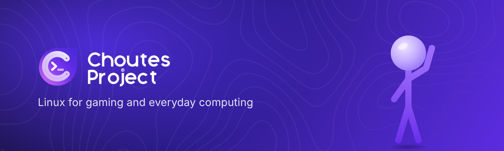

  

  <a href="https://choutes.com"><b>Website</b></a> &nbsp;&middot;&nbsp;
  <a href="https://help.choutes.com"><b>Help Center</b></a> &nbsp;&middot;&nbsp;
  <a href="https://discord.gg/nYdsKv7Fra"><b>Discord</b></a> &nbsp;&middot;&nbsp;
  <a href="https://sociabuzz.com/choutesproject/tribe"><b>Donate</b></a>

# .github

Brand assets and the default community files of Choutes Project on GitHub.

| File | Purpose |
| --- | --- |
| [assets/](assets) | Banner, logo, the Choutes Project stick figure, and screenshots |
| [FUNDING.yml](FUNDING.yml) | The Sponsor button of every repository |
| [CODE_OF_CONDUCT.md](CODE_OF_CONDUCT.md) | Standards of behavior on the Discord server and on GitHub |
| [CONTRIBUTING.md](CONTRIBUTING.md) | How to report problems and submit changes |
| [SECURITY.md](SECURITY.md) | How to report security vulnerabilities |

Bug reports and suggestions go to the [issue tracker](https://github.com/Choutes-Project/Choutes-Project/issues); questions and help to the [Help Center](https://help.choutes.com) and the [Choutes Project Discord server](https://discord.gg/nYdsKv7Fra).

---

&copy; 2026 Choutes Project. All rights reserved. 
The name and logo are trademarks. An independent project, not affiliated with Arch Linux.
